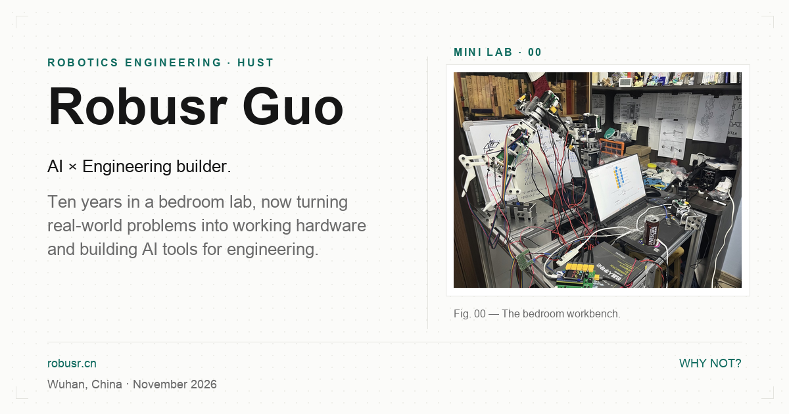

# robusr.cn

**Site personnel de Robusr Guo (郭沫晗)** : étudiant en génie robotique à HUST, il transforme des problèmes réels en matériel fonctionnel, puis construit des outils d'IA qui réduisent la distance entre une idée et une pièce.

[English](README.md) · [简体中文](README.zh.md) · **Français**

> Cinq projets sélectionnés, un parcours en six lignes, des prix et de la presse, et un court texte sur le passage de la fabrication de machines à celle d'outils.



| | |
|---|---|
| **Site en ligne** | <https://robusr.cn> |
| **Hébergement** | Cloudflare Pages, déploiement depuis `main` |
| **Stack** | Astro 7, sortie statique, sans framework client |
| **Langues** | English `/`, 简体中文 `/zh/`, Français `/fr/` |
| **Design** | mise en page éditoriale sur une colonne, 880 px maximum, une seule couleur d'accent bleu-vert profond |
| **Contrôles** | `npm run verify`, synchronisation GitHub au build, Playwright, Lighthouse |

---

## Pages du site

| Route | Langue | Notes |
|---|---|---|
| `/` | English | Entrée par défaut, `x-default` |
| `/zh/` | 简体中文 | `lang="zh-Hans"` |
| `/fr/` | Français | `lang="fr"` |
| `/404.html` | English | `noindex`, mise en page « feuille manquante », liens vers les trois langues |

Toutes les versions partagent le même modèle de contenu et le même ordre de sections. Avec JavaScript, le changement de langue conserve l'ancre courante. Aucune redirection automatique selon la langue du navigateur.

## Contenu de la page

- **Mini Lab (00) :** une photo pleine largeur de l'établi de la chambre juste après le Hero, avant les travaux sélectionnés, posée sur un passe-partout papier avec une légende « Fig. 00 » dans chaque langue.
- **Travaux sélectionnés :** Vulcan, Hsiwu, DustArrow X, OnesArm et Anteportal Labs · Sencillo, dans cet ordre fixe. Chaque projet s'ouvre sur un carrousel A–D (un panneau de 880 px à la fois ; défilement aimanté sur mobile) avec agrandissement au clic ; chaque panneau garde sa légende localisée. Les panneaux animés sont des boucles MP4/WebM silencieuses avec poster, mises en pause par `prefers-reduced-motion` ou le contrôle d'animation. Les cinq jeux sont redessinés : Vulcan (boucle système, déploiement, flux opérateur, contrat), Hsiwu (aile à trois segments, chaîne analogique, vis mère, preuves au banc), DustArrow (baies modulaires, déploiement, lancement réel au Gobi, télémétrie), OnesArm (couches modulaires, FCF, 24 agencements + MATLAB, FEA) et Sencillo (flux de forces, agencement, budget d’erreur, compilateur de contraintes). Le panneau de lancement DustArrow utilise les images *Young Edison* fournies par l’auteur, créditées à Shanghai TV. Le corps associe le texte du projet et un tableau de spécifications Tech / Preuves / GitHub. Les cartes conservent les étoiles, forks, dernier push et dernière version GitHub en direct, avec un instantané de build en secours.
- **Parcours :** six lignes, d'un atelier de chambre en 2018 à HUST en 2026.
- **Prix et presse :** premier prix du 38e CASTIC, deuxième prix du 37e CASTIC et le reportage *Young Edison* de la télévision de Shanghai.
- **Autres projets :** quatre dépôts, une ligne chacun.
- **À propos :** trois courts paragraphes et une citation sur October Sky, l'allumage du propergol au sucre, la lampe du père professeur d'art, la courbe de von Kármán, l'assemblage des PCB de fusée, les tests de perte LoRa et les tons d'encre qui relient l'ingénierie au sens.
- **Contact :** e-mail, GitHub, Anteportal Labs, localisation, liens de langue et signature.
- **Arrière-plan :** deux illustrations au trait de l'IP personnelle, un portrait collage en bas à droite et une silhouette debout en bas à gauche, sur un fond papier chaud avec une fine trame de points dans les marges. La silhouette apparaît à partir de 1200 px ; le mobile utilise une version 480 px du portrait.

## Pile technique

| Domaine | Choix |
|---|---|
| Framework | Astro 7, sortie statique, sans framework client |
| Styles | propriétés CSS natives, sans framework utilitaire |
| Typographie | Inter variable auto-hébergée, pile système pour le chinois |
| Images | 20 planches projets en WebP 1600×900 ; 10 boucles MP4/WebM silencieuses avec posters et stills d'impression 800 px ; les panneaux A sont des scans de focalisation, Hsiwu C / DustArrow B / OnesArm C des composites CAO ou MATLAB, DustArrow C les images réelles du lancement ; portrait en 260 et 512 px, Mini Lab en 480/960/1440 px avec un fallback JPEG 1440 px, deux illustrations IP transparentes dimensionnées pour leur emplacement ; WebP et fallbacks JPEG |
| Icônes | favicon SVG sur fond papier : bras robotique à l’encre, articulations creuses, pince en C et base bleu-vert ; PNG 16/32/180 px et manifeste web |
| JavaScript | environ 6 Ko non compressés d'amélioration progressive (carrousel, lightbox, contrôle d'animation, GitHub en direct) |
| Données GitHub | instantané produit au build depuis l'API GitHub ; rafraîchissement `/api/github` mis en cache en périphérie par une Cloudflare Pages Function |
| Confidentialité | aucune analyse, cookie, police tierce ou intégration ; les requêtes GitHub partent de Cloudflare, pas du navigateur du visiteur |
| Impression | feuille de style A4 avec couverture print-only : masque navigation, fonds et métadonnées live ; conserve les quatre panneaux, dates et URL externes ; stills 800 px, couverture mise à niveau en 960 px sur `beforeprint` |
| Partage social | une carte OG 1200×630 par langue, construite autour de la planche Mini Lab et de la devise localisée |
| Déploiement | Cloudflare Pages et Pages Functions, intégration Git, Node 22 |
| CI | GitHub Actions exécute `npm run verify` sur les push et les pull requests |

## Développement local

Prérequis : Node.js 22.12 ou plus récent, npm 9.6 ou plus récent.

```bash
npm ci
npm run dev       # http://localhost:4321
npm run build     # synchronise GitHub puis produit dist/
npm run preview   # prévisualiser dist/
npm run check     # cohérence du contenu, des langues, des ressources et de l'instantané GitHub
npm run sync:github # rafraîchir l'instantané GitHub versionné
npm run typecheck # astro check
npm run verify    # check + typecheck + build
```

`npm run verify` synchronise l'instantané GitHub, puis enchaîne le contrôle du contenu, le contrôle de types et le build ; le build rafraîchit à nouveau l'instantané et produit quatre pages HTML. `dist/` est ignoré par Git et reconstruit en CI. Si GitHub est injoignable, `npm run sync:github` et `npm run build` conservent l'instantané existant ; définir `GITHUB_TOKEN` augmente la limite de l'API. `/api/github` est servi par Cloudflare Pages Functions et n'existe pas dans `astro preview` ; la page utilise alors l'instantané.

## Modèle de contenu

Tous les textes visibles sont pilotés par les données.

| Chemin | Rôle |
|---|---|
| `src/data/profile.json` | nom, positionnement, introduction, statut, liens, portrait, légende du portrait, paragraphe À propos |
| `src/data/projects.json` | cinq projets phares avec textes par langue, technologies, preuves et statut |
| `src/data/project-figures.json` | légendes A/B/C/D, labels, notes de source et chemins image/vidéo/poster |
| `src/data/timeline.json` | six lignes de parcours |
| `src/data/awards.json` | trois prix et mentions presse |
| `src/data/more-work.json` | quatre projets secondaires |
| `src/data/mini-lab.json` | titre, libellé de figure, légende, texte alt et dimensions de l'image Mini Lab |
| `src/data/github.json` | instantané généré : étoiles, forks, dernier push et dernière version de chaque dépôt suivi |
| `src/i18n/en.json`, `zh.json`, `fr.json` | libellés d'interface, titres meta et descriptions |
| `content/copy-en.md` | manuscrit source en anglais |
| `content/copy-zh.md`, `copy-fr.md` | traductions chinoise et française |
| `content/glossary.md` | terminologie partagée |

L'anglais est la source de vérité. Pour modifier le contenu :

1. Modifier ensemble le manuscrit anglais et `src/data`.
2. Mettre à jour les champs chinois et français dans le même commit.
3. Garder les mêmes nombres de sections, chiffres, liens et chemins d'images dans les trois langues.
4. Lancer `npm run sync:github` après avoir ajouté, renommé ou retiré un dépôt suivi.
5. Lancer `npm run verify` et vérifier les trois routes.

`src/data/github.json` est généré ; ne pas le modifier à la main. `npm run sync:github` lit les liens des projets phares et des autres projets, puis enregistre étoiles, forks, dernier push et dernière version. Le hook `prebuild` le rafraîchit avant chaque build et conserve l'ancien fichier si GitHub est injoignable.

## Structure du projet

```text
.
├── src/
│   ├── components/   Header, Hero, MiniLab, PrintCover, ProjectList, Journey, Awards, MoreWork, About, Footer, LanguageSwitcher
│   ├── data/         profile, projects, project-figures, timeline, awards, more-work, mini-lab, instantané GitHub
│   ├── i18n/         en, zh, fr et types partagés
│   ├── layouts/      Base.astro : head, hreflang et JSON-LD
│   ├── pages/        index, zh/index, fr/index, 404, sitemap.xml, robots.txt
│   ├── scripts/      amélioration progressive et rafraîchissement GitHub
│   └── styles/       tokens.css, global.css
├── functions/        Cloudflare Pages Functions : /api/github et redirection 301 de www
├── public/           images, illustrations IP, photo Mini Lab, jeu de favicons, cartes OG, manifeste, _headers, _redirects
├── content/          manuscrits et glossaire
├── scripts/          contrôle du contenu, synchronisation GitHub, générateurs OG/IP/Mini Lab/portrait/planches projets, scripts QA
├── qa/               rapports Lighthouse, cohérence et mise en page
├── screenshots/      captures pleine page à 1440, 1024, 768 et 390 px
├── Robusr IP/        scans sources des illustrations de fond
├── .github/          workflow de vérification
└── .nvmrc            version de Node pour les builds locaux
```

## Vérification

| Contrôle | Résultat |
|---|---|
| Build et contrôles | `npm run verify` passe : contenu, `astro check` sans erreur, 4 pages |
| Synchronisation GitHub | l'instantané couvre 8 dépôts ; Vulcan résout v1.3.0 ; le test local du gestionnaire `/api/github` a renvoyé 24 dépôts publics et la version Vulcan ; un point d'accès simulé a mis la carte à 99 étoiles et v9.9.9 dans un contrôle Playwright le 2026-11-26 |
| Production | `/`, `/zh/`, `/fr/` renvoient 200 ; HTTP redirige vers HTTPS ; le 301 de `www` est implémenté dans `functions/_middleware.js` et se vérifie après le prochain déploiement |
| Lighthouse mobile, aperçu local (2026-11-27) | EN 99/100/100/100, ZH 99/100/100/100, FR 99/100/100/100 ; LCP 2,3 s ; CLS 0 ; 878–918 KiB |
| Lighthouse mobile, production (2026-11-27) | EN 98/100/93/92, ZH 98/100/93/92, FR 100/100/93/92 |
| FCP / LCP / CLS, production | 1,2–1,9 s / 1,2–1,9 s / 0 |
| Largeurs de mise en page | 1440, 1024, 768 et 390 px, sans débordement horizontal |
| JavaScript désactivé | tout le contenu reste lisible ; les cartes GitHub utilisent l'instantané |
| Ressources Mini Lab | WebP 480/960/1440 et fallback JPEG 1440 ; EXIF supprimé ; légende et alt dans les trois langues |
| Planches projets | 5 planches × 4 panneaux, toutes redessinées et auditées en SVG éditable ; Sencillo est un matériel d’objectif de conception ; OnesArm utilise uniquement le matériel v2 ; les images de lancement DustArrow sont fournies par l’auteur et créditées à Shanghai TV, Young Edison S8 |
| Animation projets | 10 boucles MP4/WebM silencieuses : Vulcan A/C, Hsiwu A/C, DustArrow A/B/C, OnesArm A/C, Sencillo A ; scans de focalisation et composites CAO, MATLAB et lancement réel ; posters en mouvement réduit |
| OG et impression | cartes OG v3 1200×630 pour EN/ZH/FR avec la planche Mini Lab ; la feuille A4 avec couverture print-only (10 pages au test du 2026-11-27) conserve les quatre panneaux, dates et URL externes et masque navigation et métadonnées live |
| Système visuel | carrousel A–D et lightbox, cadres du portrait et des projets, tableaux de spécifications, ticks de section, OG localisées, couverture imprimée et page 404 « feuille manquante » |
| Icônes | favicon SVG, PNG 16/32/180 px et manifeste ; vérifiés en 16/32/64/180 px sur onglets clairs et sombres |
| Liens externes | GitHub et les liens presse renvoient 200 |

Les chiffres Lighthouse du 2026-11-27 couvrent le build local avec Inter préchargée et le carrousel/vidéos ; les chiffres de production sont une mesure distincte du même jour sur `robusr.cn`. Best Practices vaut 93 en production parce que Cloudflare injecte encore le beacon Web Analytics et que la CSP le bloque ; SEO vaut 92 parce que le Managed robots.txt de Cloudflare ajoute des directives content-signal que l’analyseur de Lighthouse signale comme une erreur. Email Address Obfuscation reste aussi appliqué en périphérie. Ces réglages appartiennent à la zone, pas au dépôt. Résultats en ligne dans `qa/lighthouse-live-summary.json`.

Preuves complètes : [QA.md](QA.md). Captures : [screenshots/](screenshots/). Rapports Lighthouse bruts : [qa/](qa/).

Les scripts QA utilisent Playwright, à installer séparément avec `npm install --no-save playwright@1.64.1`. L'image OG se régénère avec `python3 scripts/make-og.py` ; les illustrations de fond se régénèrent depuis `Robusr IP/` avec `python3 scripts/make-ip-assets.py` ; la photo Mini Lab se régénère avec `python3 scripts/make-minilab-assets.py /chemin/vers/minilab.jpeg` ; le portrait se réétalonne avec `python3 scripts/make-portrait-assets.py`. Les nouvelles planches se construisent avec `python3 figures/build_vulcan.py` et `python3 figures/build_batch.py`, se rendent avec `node figures/render.mjs`, les scans de focalisation s'encodent avec `node figures/animate_batch.mjs`, et les composites vidéo avec ffmpeg. L'ancien `scripts/make-project-figures.py` reste pour les anciennes planches de dépôt. Les scripts de figures nécessitent Pillow ; les scripts Mini Lab et portrait suppriment les métadonnées EXIF, et le script portrait lit le fichier v2 de 512 px pour écrire les ressources v3. Les sources des dépôts, l'extrait de lancement fourni par l'auteur et les rendus Sencillo ne sont pas versionnés.

## Déploiement

Le site est hébergé sur Cloudflare Pages : <https://robusr.cn>. Le projet se construit avec `npm run build` et publie `dist/`. `astro.config.mjs` définit le site canonique ; les URL canoniques, hreflang, Open Graph, JSON-LD, `sitemap.xml` et `robots.txt` en dérivent.

1. Connecter le dépôt à Cloudflare Pages.
2. Définir `npm run build`, `dist` et `NODE_VERSION=22`.
3. Ajouter `robusr.cn` comme domaine personnalisé et activer HTTPS.
4. Pousser sur `main` ; Cloudflare Pages reconstruit automatiquement.

Cloudflare Pages déploie le dossier `functions/` avec `dist/`, donc `/api/github` ne nécessite pas de Worker séparé. La fonction lit les métadonnées publiques des dépôts avec un cache de périphérie de 10 minutes ; définir éventuellement `GITHUB_TOKEN` pour augmenter la limite de GitHub. Sans Functions, ou en cas d'échec, la page conserve l'instantané de build.

`public/_headers` ajoute les en-têtes de sécurité et de cache. Cloudflare Pages ne peut pas rediriger par hôte depuis `_redirects` ; le 301 de `www` vers l'apex est donc implémenté dans `functions/_middleware.js`, et `public/_routes.json` garde les actifs statiques hors du chemin Functions pour préserver leur cache immutable. Vérifier la redirection après le prochain déploiement. GitHub Pages est retiré ; désactiver le site dans les réglages du dépôt s'il est encore activé. Voir [DEPLOY.md](DEPLOY.md).

## Règles de contenu

- Les ressources sous `/assets/` et `/og/` sont mises en cache un an. En cas de modification d'image, écrire un nouveau nom de fichier et mettre à jour toutes les références.
- Chaque chiffre, prix, lien et statut de projet doit remonter à la bibliothèque d'information ou à une source publique.
- Les chiffres de Sencillo sont des objectifs de conception et doivent rester signalés comme tels.
- Les étoiles et les forks se rafraîchissent au build et via `/api/github` ; l'instantané de `src/data/github.json` sert de secours sans JavaScript. Ne pas le modifier à la main ; lancer `npm run sync:github`.
- Quand le contenu visible change, mettre à jour `contentDate` dans `src/data/profile.json` ; `sitemap.xml` l'utilise comme `lastmod`.
- Lancer `npm run verify` avant de pousser. GitHub Actions exécute la même commande.
- Ne pas ajouter de détails familiaux, d'adresse, de date de naissance, de notes, de classement ou de relations privées ; la phrase sur le professeur d'art dans À propos est l'exception demandée par l'auteur.
- Ne pas utiliser d'images de télévision, de logos de concours, de figures d'articles tiers ou de comptes non vérifiés ; l'extrait de lancement DustArrow de la Fig. 03C est l'unique exception, autorisée et créditée à Shanghai TV, Young Edison S8. Les figures Sencillo sont un matériel d'objectif de conception fourni par l'auteur.

## Documentation du projet

| Document | Rôle |
|---|---|
| [DELIVERY.md](DELIVERY.md) | rapport de livraison en chinois |
| [DEPLOY.md](DEPLOY.md) | Cloudflare Pages, domaine, DNS, HTTPS et retour arrière |
| [QA.md](QA.md) | cohérence, accessibilité, liens, Lighthouse et preuves de production |
| [content-inventory.md](content-inventory.md) | faits audités et vérification des liens |
| [CONTENT_GAPS.md](CONTENT_GAPS.md) | lacunes de contenu non résolues |
| [CONTENT_CONFLICTS.md](CONTENT_CONFLICTS.md) | conflits et résolutions |

## Crédits

Le portrait et les deux illustrations au trait de l'IP personnelle sont fournis par Robusr. Les deux dessins servent d'arrière-plan à faible opacité. Toutes les planches projets sont redessinées d’après les README des dépôts, les rendus et les captures d’extension/CAO ; les interfaces et modèles restent ceux des projets ; OnesArm utilise uniquement le matériel v2 ; les figures Sencillo sont un matériel d’objectif de conception fourni par l’auteur ; les images de lancement DustArrow proviennent de l’épisode *Young Edison* fourni par l’auteur et sont créditées à Shanghai TV, Young Edison S8. La photo Mini Lab est fournie par Robusr ; les copies publiées ont leurs métadonnées EXIF supprimées. Le site n'utilise pas d'autres images de télévision, de logos de concours ni de figures d'articles tiers. Les étoiles, forks, dates de dernier push et versions GitHub proviennent de l'API publique GitHub et sont mis en cache en périphérie.
