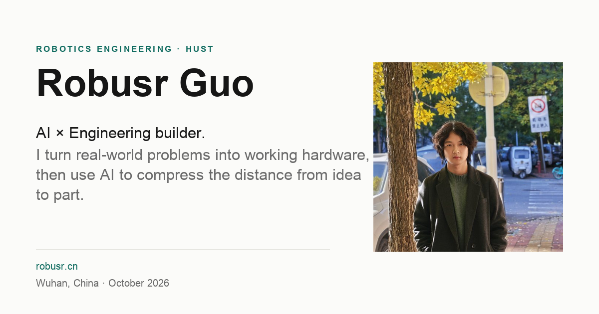

# robusr.cn

**Personal homepage of Robusr Guo (郭沫晗)**: a robotics engineering student at HUST who turns real-world problems into working hardware, then builds AI tools that shorten the distance from an idea to a part.

**English** · [简体中文](README.zh.md) · [Français](README.fr.md)

> Five selected projects, a six-row journey, awards and media, and a short essay on moving from building machines to building tools.



| | |
|---|---|
| **Live site** | <https://robusr.cn> |
| **Hosting** | Cloudflare Pages, deployed from `main` |
| **Stack** | Astro 7, static output, no client framework |
| **Locales** | English `/`, 简体中文 `/zh/`, Français `/fr/` |
| **Design** | single-column editorial layout, 880 px max width, one deep-teal accent |
| **Quality gates** | `npm run verify`, build-time GitHub sync, Playwright, Lighthouse |

---

## Pages

| Route | Language | Notes |
|---|---|---|
| `/` | English | Default entry, `x-default` |
| `/zh/` | 简体中文 | `lang="zh-Hans"` |
| `/fr/` | Français | `lang="fr"` |
| `/404.html` | English | `noindex`, links to all three languages |

All versions share one content model and the same section order. With JavaScript enabled, switching language preserves the current anchor. There is no automatic redirect from browser language.

## What the page contains

- **Selected Work:** Vulcan, Hsiwu, DustArrow X, OnesArm, and Anteportal Labs · Sencillo, in that fixed order. Repository cards show live GitHub stars, forks, last push, and the latest release tag, falling back to a build-time snapshot without JavaScript.
- **Journey:** six rows from a bedroom workshop in 2018 to HUST in 2026.
- **Awards & Media:** 38th CASTIC first prize, 37th CASTIC second prize, and the Shanghai TV *Young Edison* feature.
- **More Work:** four repositories, one line each.
- **About:** one paragraph on October Sky, the sugar-propellant ignition that started it all, the floor lamp borrowed from his art-teacher father, the von Kármán curve, modular rocket PCB assembly, LoRa packet-loss tests, and the ink tones that connect engineering to meaning.
- **Contact:** email, GitHub, Anteportal Labs, location, language links, and the signature.
- **Background:** two hand-drawn personal IP illustrations, a collage portrait anchored bottom-right and a standing figure bottom-left, over a warm paper wash with a faint drafting dot grid in the margins. The standing figure appears from 1200 px up; mobile uses a 480 px version of the portrait.

## Stack

| Area | Choice |
|---|---|
| Framework | Astro 7, static output, no client framework |
| Styling | native CSS custom properties, no utility framework |
| Type | self-hosted Inter variable font, system CJK stack |
| Images | project images at 480 and 960 px, portrait at 260 and 512 px, two transparent line-art IP assets sized for their display slots; WebP, with a JPEG fallback for the portrait |
| JavaScript | about 2.3 KB of progressive enhancement |
| GitHub data | build-time snapshot from the GitHub API; edge-cached `/api/github` refresh through a Cloudflare Pages Function |
| Privacy | no analytics, cookies, third-party fonts, or embeds; GitHub requests leave from Cloudflare, not the visitor's browser |
| Deployment | Cloudflare Pages and Pages Functions, Git integration, Node 22 |
| CI | GitHub Actions runs `npm run verify` on pushes and pull requests |

## Local development

Requirements: Node.js 22.12 or newer and npm 9.6 or newer.

```bash
npm ci
npm run dev       # http://localhost:4321
npm run build     # sync GitHub stats, then render static output in dist/
npm run preview   # preview dist/ at http://localhost:4321
npm run check     # content, locale, asset, and GitHub snapshot consistency
npm run sync:github # refresh the checked-in GitHub snapshot
npm run typecheck # astro check
npm run verify    # check + typecheck + build
```

`npm run verify` syncs the GitHub snapshot, runs the content check, the type check, and the build; the build refreshes the snapshot again and produces four HTML pages. `dist/` is ignored by git and rebuilt in CI. `npm run sync:github` and `npm run build` keep the existing snapshot when GitHub is unreachable; set `GITHUB_TOKEN` to raise the API rate limit. The live `/api/github` endpoint is served by Cloudflare Pages Functions and is not part of `astro preview`; the page falls back to the snapshot there.

## Content model

All visible copy is data-driven.

| Path | Purpose |
|---|---|
| `src/data/profile.json` | Name, positioning, intro, status, links, portrait, About paragraph |
| `src/data/projects.json` | Five featured projects with per-locale copy, tech, evidence, and status |
| `src/data/timeline.json` | Six Journey rows |
| `src/data/awards.json` | Three award and media rows |
| `src/data/more-work.json` | Four secondary projects |
| `src/data/github.json` | Generated snapshot: stars, forks, last push, and latest release for each tracked repository |
| `src/i18n/en.json`, `zh.json`, `fr.json` | UI labels, meta titles, and descriptions |
| `content/copy-en.md` | English source manuscript |
| `content/copy-zh.md`, `copy-fr.md` | Chinese and French translations |
| `content/glossary.md` | Shared terminology |

English is the source of truth. When editing:

1. Change the English manuscript and `src/data` together.
2. Update the Chinese and French fields in the same commit.
3. Keep section counts, numbers, links, and image paths identical across locales.
4. Run `npm run sync:github` after adding, renaming, or removing a tracked repository.
5. Run `npm run verify` and check all three routes.

`src/data/github.json` is generated; do not hand-edit it. `npm run sync:github` reads the featured and More Work repository links, then records stars, forks, last push, and the latest release. The `prebuild` hook refreshes it before every build and keeps the old file if GitHub is unreachable.

## Project structure

```text
.
├── src/
│   ├── components/   Header, Hero, ProjectList, Journey, Awards, MoreWork, About, Footer, LanguageSwitcher
│   ├── data/         profile, projects, timeline, awards, more-work, generated GitHub snapshot
│   ├── i18n/         en, zh, fr, and shared types
│   ├── layouts/      Base.astro with head, hreflang, and JSON-LD
│   ├── pages/        index, zh/index, fr/index, 404, sitemap.xml, robots.txt
│   ├── scripts/      progressive enhancement and live GitHub refresh
│   └── styles/       tokens.css, global.css
├── functions/        Cloudflare Pages Function for /api/github
├── public/           images, hand-drawn IP art, favicon, OG image, _headers, _redirects
├── content/          copy manuscripts and glossary
├── scripts/          content check, GitHub sync, OG and IP asset generators, and QA helpers
├── qa/               Lighthouse, consistency, and layout reports
├── screenshots/      full-page captures at 1440, 1024, 768, and 390 px
├── Robusr IP/        source scans for the background artwork
├── .github/          verify workflow
└── .nvmrc            Node version for local builds
```

## Verification

| Check | Result |
|---|---|
| Build and checks | `npm run verify` passes: content check, `astro check` with 0 errors, 4 pages built |
| GitHub sync | Snapshot covers 8 repositories; Vulcan resolves to v1.3.0; `/api/github` returned 24 public repositories and the Vulcan release in a local handler test; a mocked endpoint updated the card to 99 stars and v9.9.9 in a Playwright check on 2026-11-26 |
| Production | `/`, `/zh/`, `/fr/` return 200; HTTP redirects to HTTPS; `www` returns 200 and still needs a 301 |
| Lighthouse mobile, local preview (2026-10-22) | Performance 99, Accessibility 100, Best Practices 100, SEO 100 in all three locales |
| Lighthouse mobile, production (2026-10-22) | EN 97/100/92/100, ZH 98/100/92/100, FR 99/100/92/100 |
| LCP / CLS, production | LCP 1.8–2.2 s; CLS 0–0.069, measured before the portrait `aspect-ratio` fix |
| Layout widths | 1440, 1024, 768, and 390 px, no horizontal overflow |
| JavaScript disabled | all content readable; GitHub cards use the build-time snapshot |
| Outbound links | GitHub and media links return 200 |

The Lighthouse figures predate the live GitHub module and should be re-run for the current build. Production Best Practices is 92 because Cloudflare still injects the Web Analytics beacon and the CSP blocks it. Email Address Obfuscation and Managed robots.txt are also still applied at the edge, so the live page differs from the local build. These are zone settings, not repository settings. Production results are in `qa/lighthouse-live-summary.json`.

Full evidence: [QA.md](QA.md). Screenshots: [screenshots/](screenshots/). Raw Lighthouse reports: [qa/](qa/).

The QA scripts use Playwright, installed separately with `npm install --no-save playwright@1.64.1`. The OG image is regenerated with `python3 scripts/make-og.py`; the background art is regenerated from `Robusr IP/` with `python3 scripts/make-ip-assets.py`. Both generators require Pillow.

## Deployment

Production is Cloudflare Pages at <https://robusr.cn>. The project builds with `npm run build` and publishes `dist/`. `astro.config.mjs` sets the canonical site; canonical URLs, hreflang, Open Graph, JSON-LD, `sitemap.xml`, and `robots.txt` derive from it.

1. Connect the repository to Cloudflare Pages.
2. Set build command `npm run build`, output directory `dist`, and `NODE_VERSION=22`.
3. Add `robusr.cn` as a custom domain and enable HTTPS.
4. Push to `main`. Cloudflare Pages rebuilds automatically.

Cloudflare Pages deploys the `functions/` directory alongside `dist/`, so `/api/github` works without a separate worker. The function reads public repository metadata with a 10-minute edge cache; set an optional `GITHUB_TOKEN` environment variable to raise GitHub's rate limit. Without Functions, or when the endpoint fails, the page keeps the build-time snapshot.

`public/_headers` adds security and cache headers. Cloudflare Pages cannot redirect by host from `_redirects`, so that file only documents the limitation. `www.robusr.cn` currently resolves and returns 200; configure a Redirect Rule to send it to the apex with a 301. GitHub Pages is retired; disable the Pages site in repository settings if it is still enabled. See [DEPLOY.md](DEPLOY.md).

## Content rules

- Assets under `/assets/` and `/og/` are cached for one year. When an image changes, write it to a new filename and update every reference.
- Every number, award, link, and project status must trace back to the info library or a public source.
- Sencillo figures are design targets and must stay labeled as such.
- Star and fork counts refresh at build time and from `/api/github`; the static snapshot in `src/data/github.json` is the no-JavaScript fallback. Never hand-edit it; run `npm run sync:github`.
- When visible content changes, update `contentDate` in `src/data/profile.json`; `sitemap.xml` uses it as `lastmod`.
- Run `npm run verify` before pushing. The same command runs in GitHub Actions.
- Do not add family details, addresses, birthdays, scores, rankings, or private relationships; the art-teacher sentence in About is the owner-requested exception.
- Do not use TV stills, competition logos, third-party paper figures, or unverified accounts.

## Documentation

| Document | Purpose |
|---|---|
| [DELIVERY.md](DELIVERY.md) | Chinese delivery report |
| [DEPLOY.md](DEPLOY.md) | Cloudflare Pages, domain, DNS, HTTPS, and rollback |
| [QA.md](QA.md) | Consistency, accessibility, link, Lighthouse, and production evidence |
| [content-inventory.md](content-inventory.md) | Audited facts and link checks |
| [CONTENT_GAPS.md](CONTENT_GAPS.md) | Unresolved content |
| [CONTENT_CONFLICTS.md](CONTENT_CONFLICTS.md) | Conflicts and resolutions |

## Credits

Portrait and the two line-art personal IP illustrations provided by Robusr. Both drawings are used as low-opacity background art. Project images come from each project repository and the Anteportal Labs organization page. The site does not use TV stills, competition logos, or third-party paper figures. GitHub stars, forks, last-push dates, and release tags come from the public GitHub API and are cached at the edge.
