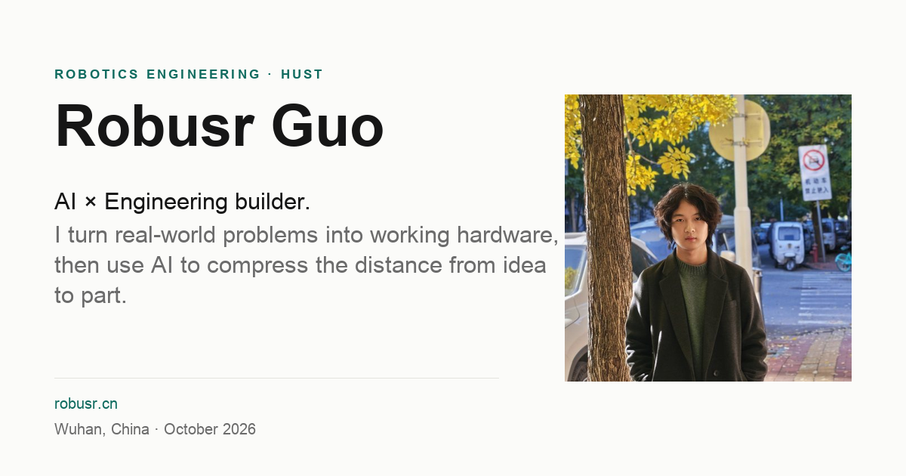

# robusr.cn

Personal homepage of **Robusr Guo (郭沫晗)**, built with Astro as a static site.

The page follows one narrative in three languages: real-world problems turned into working hardware, then AI tools that shorten the distance from an idea to a part. It presents five selected projects, a six-entry timeline, awards and media, and a short essay on the move from building machines to building tools.



**Status:** live at <https://robusr.cn>, deployed on Cloudflare Pages from `main`.

## Pages

| Route | Language | Notes |
|---|---|---|
| `/` | English | Default entry, `x-default` |
| `/zh/` | 简体中文 | `lang="zh-Hans"` |
| `/fr/` | Français | `lang="fr"` |
| `/404.html` | English | `noindex`, links to all three languages |

All versions share one content model and the same section order. With JavaScript enabled, switching language preserves the current anchor. There is no automatic redirect from browser language.

## What the page contains

- **Selected Work:** Vulcan, Hsiwu, DustArrow X, OnesArm, and Anteportal Labs · Sencillo, in that fixed order.
- **Journey:** six rows from Arduino in 2018 to HUST and Anteportal Labs in 2026.
- **Awards & Media:** 38th CASTIC first prize, 37th CASTIC second prize, and the Shanghai TV *Young Edison* feature.
- **More Work:** six repositories, one line each.
- **About:** two paragraphs on Guyuan's sandstorms and the move upstream into AI tools for CAD and fabrication.
- **Contact:** email, GitHub, Anteportal Labs, location, language links, and the signature.
- **Background:** a line-art personal IP illustration, used as a faint site-wide watermark.

## Stack

| Area | Choice |
|---|---|
| Framework | Astro 7, static output, no client framework |
| Styling | native CSS custom properties, no utility framework |
| Type | self-hosted Inter variable font, system CJK stack |
| Images | project images at 480 and 960 px, portrait at 260 and 512 px, 850 px transparent IP watermark; WebP, with a JPEG fallback for the portrait |
| JavaScript | about 1 KB of progressive enhancement |
| Privacy | no analytics, cookies, third-party fonts, or embeds |
| Deployment | Cloudflare Pages, Git integration, Node 22 |

## Local development

Requirements: Node.js 22.12 or newer and npm 9.6 or newer.

```bash
npm ci
npm run dev       # http://localhost:4321
npm run build     # static output in dist/
npm run preview   # preview dist/ at http://localhost:4321
```

`npm run build` produces four HTML pages. `dist/` is ignored by git and rebuilt in CI.

## Content model

All visible copy is data-driven.

| Path | Purpose |
|---|---|
| `src/data/profile.json` | Name, positioning, intro, status, links, portrait, About paragraphs |
| `src/data/projects.json` | Five featured projects with per-locale copy, tech, evidence, and status |
| `src/data/timeline.json` | Six Journey rows |
| `src/data/awards.json` | Three award and media rows |
| `src/data/more-work.json` | Six secondary projects |
| `src/i18n/en.json`, `zh.json`, `fr.json` | UI labels, meta titles, and descriptions |
| `content/copy-en.md` | English source manuscript |
| `content/copy-zh.md`, `copy-fr.md` | Chinese and French translations |
| `content/glossary.md` | Shared terminology |

English is the source of truth. When editing:

1. Change the English manuscript and `src/data` together.
2. Update the Chinese and French fields in the same commit.
3. Keep section counts, numbers, links, and image paths identical across locales.
4. Run `npm run build` and check all three routes.

## Project structure

```text
.
├── src/
│   ├── components/   Header, Hero, ProjectList, Journey, Awards, MoreWork, About, Footer, LanguageSwitcher
│   ├── data/         profile, projects, timeline, awards, more-work
│   ├── i18n/         en, zh, fr
│   ├── layouts/      Base.astro with head, hreflang, and JSON-LD
│   ├── pages/        index, zh/index, fr/index, 404, sitemap.xml, robots.txt
│   ├── scripts/      progressive enhancement
│   └── styles/       tokens.css, global.css
├── public/           images, IP watermark, favicon, OG image, _headers, _redirects
├── content/          copy manuscripts and glossary
├── scripts/          OG image generator and QA helpers
├── qa/               Lighthouse, consistency, and layout reports
├── screenshots/      full-page captures at 1440, 1024, 768, and 390 px
└── .nvmrc            Node version for local builds
```

## Verification

| Check | Result |
|---|---|
| Build | 4 pages, no errors |
| Production | `/`, `/zh/`, `/fr/` return 200 at <https://robusr.cn>; HTTP redirects to HTTPS |
| Lighthouse mobile, local preview | Performance, Accessibility, Best Practices, SEO: 100 each |
| Lighthouse mobile, production | Performance 96, Accessibility 100, Best Practices 92, SEO 100 |
| LCP / CLS, production | 2.0–2.1 s / 0 |
| Layout widths | 1440, 1024, 768, and 390 px, no horizontal overflow |
| JavaScript disabled | all content readable |
| Outbound links | GitHub and media links return 200 |

Production Best Practices is 92 because Cloudflare's Web Analytics beacon is injected and blocked by the CSP. Disabling RUM in the Cloudflare zone should restore 100. Production results are in `qa/lighthouse-live-summary.json`.

Full evidence: [QA.md](QA.md). Screenshots: [screenshots/](screenshots/). Raw Lighthouse reports: [qa/](qa/).

The QA scripts use Playwright, installed separately with `npm install --no-save playwright@1.64.1`. The OG image can be regenerated with `python3 scripts/make-og.py`; Pillow is required.

## Deployment

Production is Cloudflare Pages at <https://robusr.cn>. The project builds with `npm run build` and publishes `dist/`. `astro.config.mjs` sets the canonical site; canonical URLs, hreflang, Open Graph, JSON-LD, `sitemap.xml`, and `robots.txt` derive from it.

1. Connect the repository to Cloudflare Pages.
2. Set build command `npm run build`, output directory `dist`, and `NODE_VERSION=22`.
3. Add `robusr.cn` as a custom domain and enable HTTPS.
4. Push to `main`. Cloudflare Pages rebuilds automatically.

`public/_headers` adds security and cache headers. `public/_redirects` sends `www` to the apex once the `www` host is attached. GitHub Pages is retired; disable the Pages site in repository settings if it is still enabled. See [DEPLOY.md](DEPLOY.md).

## Content rules

- Every number, award, link, and project status must trace back to the info library or a public source.
- Sencillo figures are design targets and must stay labeled as such.
- Star counts are snapshots dated October 2026 and carry that date in the UI.
- Do not add family details, addresses, birthdays, scores, rankings, or private relationships.
- Do not use TV stills, competition logos, third-party paper figures, or unverified accounts.

## Documentation

| Document | Purpose |
|---|---|
| [DELIVERY.md](DELIVERY.md) | Chinese delivery report |
| [DEPLOY.md](DEPLOY.md) | Cloudflare Pages, domain, DNS, HTTPS, and rollback |
| [QA.md](QA.md) | Consistency, accessibility, link, Lighthouse, and production evidence |
| [content-inventory.md](content-inventory.md) | Audited facts and link checks |
| [CONTENT_GAPS.md](CONTENT_GAPS.md) | Unresolved content |
| [CONTENT_CONFLICTS.md](CONTENT_CONFLICTS.md) | Conflicts and resolutions |

## Credits

Portrait and the line-art personal IP illustration provided by Robusr. The illustration is used as a site-wide background watermark at low opacity. Project images come from each project repository and the Anteportal Labs organization page. The site does not use TV stills, competition logos, or third-party paper figures.
