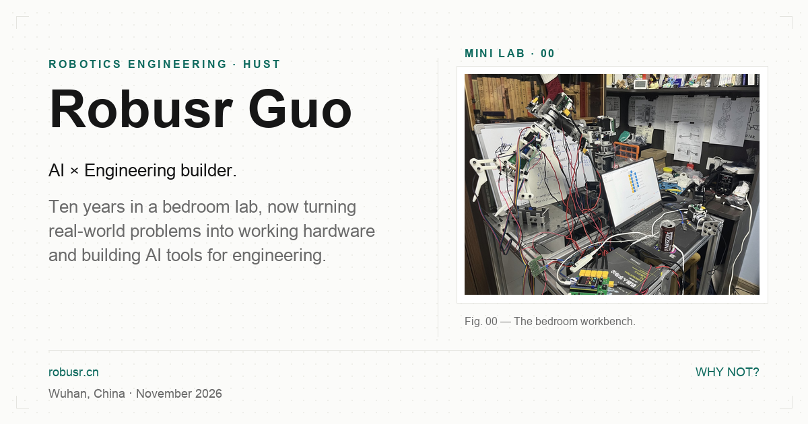

# robusr.cn

**郭沫晗的个人主页**：华中科技大学机器人工程专业学生，把真实问题做成能运行的硬件，再构建缩短从想法到零件距离的 AI 工具。

[English](README.md) · **简体中文** · [Français](README.fr.md)

> 五个代表项目、六行经历、奖项与报道，以及一段关于从造机器走向造工具的短文。



| | |
|---|---|
| **线上站点** | <https://robusr.cn> |
| **托管** | Cloudflare Pages，从 `main` 分支自动部署 |
| **技术栈** | Astro 7，静态输出，无客户端框架 |
| **语言** | English `/`、简体中文 `/zh/`、Français `/fr/` |
| **设计** | 单栏编辑式布局，最大宽度 880 px，只有一个深青强调色 |
| **质量检查** | `npm run verify`、构建时 GitHub 同步、Playwright、Lighthouse |

---

## 页面

| 路由 | 语言 | 说明 |
|---|---|---|
| `/` | English | 默认入口，`x-default` |
| `/zh/` | 简体中文 | `lang="zh-Hans"` |
| `/fr/` | Français | `lang="fr"` |
| `/404.html` | English | `noindex`，缺失图纸版式，链接到三种语言 |

所有版本共享同一套内容模型和相同的区块顺序。启用 JavaScript 时，切换语言会保留当前锚点；不会根据浏览器语言自动跳转。

## 页面内容

- **迷你实验室（00）：** Hero 之后、代表项目之前的全宽卧室工作台照片，带纸白图版边框与三语「图 00」图注。
- **代表项目：** Vulcan、Hsiwu、DustArrow X、OnesArm、Anteportal Labs · Sencillo，顺序固定。每个项目以全宽 A/B/C/D 学术图版开头：一个短 GIF 面板 + 三个架构、渲染或分析面板，每个面板带图注。下方正文与「技术 / 证据 / GitHub」规格表组成双栏。仓库数据仍显示实时的 stars、forks、最近推送与 Release，无 JavaScript 时回退构建快照。
- **经历：** 6 行，从 2018 年的卧室工作室到 2026 年的华中科技大学。
- **奖项与报道：** 第 38 届全国青少年科技创新大赛一等奖、第 37 届二等奖，以及上海电视台《少年爱迪生》。
- **其他项目：** 4 个仓库，每个一行。
- **关于：** 一段文字，从《十月的天空》和硝糖燃料点火讲起，到美术老师父亲的落地台灯、冯卡门曲线、箭体 PCB 装配、LoRa 丢包测试与水墨五色。
- **联系：** 邮箱、GitHub、Anteportal Labs、所在地、语言链接与签名。
- **背景：** 两幅手绘个人 IP 线稿，右下角拼贴肖像、左下角站立人物，叠在带有极淡制图点阵的暖色纸感底色上。站立人物从 1200 px 起显示；移动端使用 480 px 版本的肖像。

## 技术栈

| 领域 | 选择 |
|---|---|
| 框架 | Astro 7，静态输出，无客户端框架 |
| 样式 | 原生 CSS 自定义属性，无工具类框架 |
| 字体 | 自托管 Inter 可变字体，中文使用系统字体栈 |
| 图片 | 项目学术图版：20 个面板使用 800×450 WebP，每个项目一个 400–640 px 单次播放 GIF，减少动态时回退 960 px WebP/JPEG；肖像 260/512 px，迷你实验室 480/960/1440 px 并提供 1440 px JPEG 回退，两套透明线稿 IP 素材按展示位置裁切；WebP 与 JPEG 回退 |
| 图标 | 纸白底 + 墨色机械臂线稿 + 空心关节 + C 形夹爪 + 深青底座点缀的 SVG favicon、16/32/180 px PNG 回退与 web manifest |
| JavaScript | 约 2.3 KB 渐进增强 |
| GitHub 数据 | 构建时从 GitHub API 生成快照；Cloudflare Pages Function 提供 `/api/github` 边缘缓存刷新 |
| 隐私 | 无统计、Cookie、第三方字体或嵌入；GitHub 请求由 Cloudflare 发出，不暴露访客浏览器 |
| 打印 | A4 打印样式并附带 print-only 封面：隐藏导航、背景与实时元信息，保留图版、日期与站外 URL |
| 社交分享 | 每种语言一张 1200×630 OG 卡片，使用迷你实验室图版与本地化标语 |
| 部署 | Cloudflare Pages 与 Pages Functions，Git 集成，Node 22 |
| CI | GitHub Actions 在推送和 PR 时运行 `npm run verify` |

## 本地开发

环境要求：Node.js 22.12 或更新版本，npm 9.6 或更新版本。

```bash
npm ci
npm run dev       # http://localhost:4321
npm run build     # 先同步 GitHub 数据，再静态输出到 dist/
npm run preview   # 预览 dist/
npm run check     # 内容、语言、资源与 GitHub 快照一致性检查
npm run sync:github # 刷新仓库内的 GitHub 快照
npm run typecheck # astro check
npm run verify    # check + typecheck + build
```

`npm run verify` 会先同步 GitHub 快照，再依次运行内容检查、类型检查和构建；构建时会再刷新一次快照，最终生成 4 个 HTML 页面。`dist/` 不进入 Git，由 CI 重建。GitHub 不可达时，`npm run sync:github` 与 `npm run build` 保留现有快照；设置 `GITHUB_TOKEN` 可提高 API 限额。`/api/github` 由 Cloudflare Pages Functions 提供，`astro preview` 中不存在；此时页面使用构建快照。

## 内容模型

所有可见文案都由数据驱动。

| 路径 | 用途 |
|---|---|
| `src/data/profile.json` | 姓名、定位、简介、状态、链接、肖像、肖像图注、关于段落 |
| `src/data/projects.json` | 5 个代表项目，含三语文案、技术、证据与状态 |
| `src/data/project-figures.json` | A/B/C/D 面板图注、标签、来源说明与 GIF/静态图路径 |
| `src/data/timeline.json` | 6 行经历 |
| `src/data/awards.json` | 3 条奖项与报道 |
| `src/data/more-work.json` | 4 个其他项目 |
| `src/data/mini-lab.json` | 迷你实验室标题、图注编号、说明、alt 与图片尺寸 |
| `src/data/github.json` | 生成的快照：每个追踪仓库的 stars、forks、最近推送与最新 Release |
| `src/i18n/en.json`, `zh.json`, `fr.json` | 界面文案、meta 标题与描述 |
| `content/copy-en.md` | 英文源稿 |
| `content/copy-zh.md`, `copy-fr.md` | 中文与法文译稿 |
| `content/glossary.md` | 共享术语 |

英文是唯一事实源。编辑时：

1. 同步修改英文源稿与 `src/data`。
2. 同一次提交内更新中文与法文字段。
3. 保持三语的区块数量、数字、链接与图片路径一致。
4. 增加、重命名或删除追踪仓库后，运行 `npm run sync:github`。
5. 运行 `npm run verify`，并检查三个路由。

`src/data/github.json` 是生成文件，不要手工编辑。`npm run sync:github` 从代表项目与其他项目的仓库链接读取数据，记录 stars、forks、最近推送与最新 Release；`prebuild` 会在每次构建前刷新，GitHub 不可达时保留旧文件。

## 项目结构

```text
.
├── src/
│   ├── components/   Header、Hero、MiniLab、PrintCover、ProjectList、Journey、Awards、MoreWork、About、Footer、LanguageSwitcher
│   ├── data/         profile、projects、project-figures、timeline、awards、more-work、mini-lab、生成的 GitHub 快照
│   ├── i18n/         en、zh、fr 与共享类型
│   ├── layouts/      Base.astro，负责 head、hreflang 与 JSON-LD
│   ├── pages/        index、zh/index、fr/index、404、sitemap.xml、robots.txt
│   ├── scripts/      渐进增强与 GitHub 实时刷新
│   └── styles/       tokens.css、global.css
├── functions/        Cloudflare Pages Function，提供 /api/github
├── public/           图片、手绘 IP 素材、迷你实验室照片、favicon 套件、OG 卡片、manifest、_headers、_redirects
├── content/          三语文稿与术语表
├── scripts/          内容检查、GitHub 同步、OG/IP/迷你实验室/肖像/项目图版生成、QA 脚本
├── qa/               Lighthouse、一致性与布局报告
├── screenshots/      1440、1024、768、390 px 全页截图
├── Robusr IP/        背景线稿的原始扫描
├── .github/          验证工作流
└── .nvmrc            本地构建使用的 Node 版本
```

## 验证

| 检查 | 结果 |
|---|---|
| 构建与检查 | `npm run verify` 通过：内容检查、`astro check` 0 错误、构建 4 个页面 |
| GitHub 同步 | 快照覆盖 8 个仓库；Vulcan 解析为 v1.3.0；本地处理器测试中 `/api/github` 返回 24 个公开仓库与 Vulcan Release；2026-11-26 的 Playwright 测试用 mock 接口把卡片更新为 99 stars 与 v9.9.9 |
| 线上 | `/`、`/zh/`、`/fr/` 返回 200；HTTP 跳转 HTTPS；`www` 返回 200，仍需 301 |
| 本地 Lighthouse，移动端（2026-10-22） | 三种语言的 Performance 99、Accessibility 100、Best Practices 100、SEO 100 |
| 线上 Lighthouse，移动端（2026-10-22） | EN 97/100/92/100，ZH 98/100/92/100，FR 99/100/92/100 |
| 线上 LCP / CLS | LCP 1.8–2.2 s；CLS 0–0.069，测量于肖像 `aspect-ratio` 修复之前 |
| 布局宽度 | 1440、1024、768、390 px 均无横向溢出 |
| 关闭 JavaScript | 正文完整可读；GitHub 卡片使用构建快照 |
| 迷你实验室素材 | 480/960/1440 WebP 与 1440 JPEG 回退；已去除 EXIF；三语说明与 alt |
| 项目图版 | 5 张图版 × 4 个面板；四个来自仓库，Sencillo 为作者提供的设计目标图版；OnesArm 仅使用 v2 资料；DustArrow 发射画面已授权并标注来源 |
| 项目 GIF | Vulcan 自动化、Hsiwu 连杆、DustArrow 展开、OnesArm FEA 扫描、Sencillo 力流；单次播放，减少动态时使用 WebP 静态图 |
| OG 与打印 | 中英法三张 1200×630 OG 卡片使用迷你实验室图版；A4 打印样式带 print-only 封面（8 页），保留图版、日期与站外 URL，隐藏导航与实时元信息 |
| 视觉系统 | 肖像与项目图细框、规格表、章节页边刻度、本地化 OG、打印封面与缺失图纸 404 |
| 图标 | SVG favicon、16/32/180 px PNG 与 manifest；已在浅色/深色标签栏的 16/32/64/180 px 下检查 |
| 站外链接 | GitHub 与媒体链接返回 200 |

Lighthouse 数据早于本次 GitHub 实时模块，引用前应重新测量。线上 Best Practices 为 92，因为 Cloudflare 仍注入 Web Analytics beacon，并被 CSP 拦截；Email Address Obfuscation 与 Managed robots.txt 也仍在边缘生效，因此线上页面与本地构建不同。这些是 zone 设置，不在仓库内。线上数据见 `qa/lighthouse-live-summary.json`。

完整证据见 [QA.md](QA.md)；截图见 [screenshots/](screenshots/)；Lighthouse 原始报告见 [qa/](qa/)。

QA 脚本使用 Playwright，需单独安装：`npm install --no-save playwright@1.64.1`。OG 图片可用 `python3 scripts/make-og.py` 重新生成；背景素材可用 `python3 scripts/make-ip-assets.py` 从 `Robusr IP/` 重新生成；迷你实验室图片可用 `python3 scripts/make-minilab-assets.py /path/to/minilab.jpeg` 重新生成；肖像可用 `python3 scripts/make-portrait-assets.py` 重新调色；项目 A/B/C/D 图版可用 `python3 scripts/make-project-figures.py --assets /path/to/repo-assets --gifs /path/to/repo-gifs --pdf-pages /path/to/pdf-pages` 重建。生成脚本都需要 Pillow，迷你实验室与肖像脚本会去除 EXIF；肖像脚本读取 v2 的 512 px 文件并写出 v3 资源。源仓库素材与 Sencillo 图版渲染不进入本仓库。

## 部署

线上站点由 Cloudflare Pages 托管：<https://robusr.cn>。项目通过 `npm run build` 构建并发布 `dist/`。`astro.config.mjs` 设置 canonical 站点，canonical、hreflang、Open Graph、JSON-LD、`sitemap.xml` 与 `robots.txt` 都从它派生。

1. 将仓库连接到 Cloudflare Pages。
2. 构建命令设为 `npm run build`，输出目录设为 `dist`，`NODE_VERSION=22`。
3. 添加 `robusr.cn` 自定义域名并启用 HTTPS。
4. 推送到 `main`，Cloudflare Pages 自动重建。

Cloudflare Pages 会把 `functions/` 与 `dist/` 一起部署，因此 `/api/github` 无需单独 Worker。该函数读取公开仓库信息，边缘缓存 10 分钟；可设置可选的 `GITHUB_TOKEN` 环境变量提高 GitHub 限额。Functions 不可用或接口失败时，页面保留构建快照。

`public/_headers` 添加安全与缓存响应头。Cloudflare Pages 无法通过 `_redirects` 做域名级跳转，因此该文件只记录这一限制。`www.robusr.cn` 当前可访问并返回 200；需要在 Cloudflare 创建 Redirect Rule，将其 301 到主域名。GitHub Pages 已停用；如果仓库后台仍启用 Pages，请关闭。详见 [DEPLOY.md](DEPLOY.md)。

## 内容规则

- `/assets/` 与 `/og/` 下的资源缓存一年。图片变更时写入新文件名，并更新所有引用。
- 每个数字、奖项、链接与项目状态都必须能追溯到信息库或公开来源。
- Sencillo 的数字是设计目标，必须保持这一标注。
- 星标与 fork 数在构建时和 `/api/github` 刷新；`src/data/github.json` 的静态快照是无 JavaScript 时的回退。不要手工编辑该文件，运行 `npm run sync:github`。
- 可见内容变化时，更新 `src/data/profile.json` 中的 `contentDate`；`sitemap.xml` 用它作为 `lastmod`。
- 推送前运行 `npm run verify`。GitHub Actions 会运行同一命令。
- 不加入家庭信息、住址、生日、分数、排名或私人关系；关于部分中应作者要求加入的美术老师一句是唯一例外。
- 不使用电视画面、比赛标志、第三方论文插图或未经验证的账号；图 03C 的 DustArrow 发射画面是唯一例外，已授权并标注为上海电视台《少年爱迪生》第八季。Sencillo 图版为作者提供的设计目标资料。

## 文档

| 文档 | 用途 |
|---|---|
| [DELIVERY.md](DELIVERY.md) | 中文交付报告 |
| [DEPLOY.md](DEPLOY.md) | Cloudflare Pages、域名、DNS、HTTPS 与回滚 |
| [QA.md](QA.md) | 一致性、无障碍、链接、Lighthouse 与线上证据 |
| [content-inventory.md](content-inventory.md) | 事实审计与链接检查 |
| [CONTENT_GAPS.md](CONTENT_GAPS.md) | 未解决的内容缺口 |
| [CONTENT_CONFLICTS.md](CONTENT_CONFLICTS.md) | 冲突与处理方式 |

## 鸣谢

肖像与两幅手绘个人 IP 线稿由 Robusr 提供，两幅画作都用作低透明度背景。项目图版与 GIF 来自各项目仓库；OnesArm 仅使用 v2 资料；Sencillo 图版为作者提供的设计目标资料；DustArrow 发射画面已获授权并标注为上海电视台《少年爱迪生》第八季。迷你实验室照片由 Robusr 提供，发布版本已去除 EXIF 元数据。站点不使用其他电视画面、比赛标志或第三方论文插图。GitHub stars、forks、最近推送与 Release 标签来自公开 GitHub API，并在边缘缓存。
