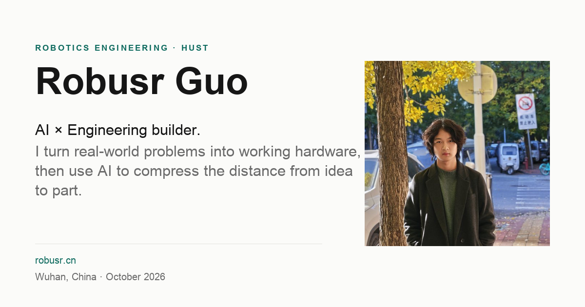

# robusr.cn

**郭沫晗的个人主页**：华中科技大学机器人工程专业学生，把真实问题做成能运行的硬件，再构建缩短从想法到零件距离的 AI 工具。

[English](README.md) · **简体中文** · [Français](README.fr.md)

> 五个代表项目、六行经历、奖项与报道，以及一段关于从造机器走向造工具的短文。



| | |
|---|---|
| **线上站点** | <https://robusr.cn> |
| **托管** | Cloudflare Pages，从 `main` 分支自动部署 |
| **技术栈** | Astro 7，静态输出，无客户端框架 |
| **语言** | English `/`、简体中文 `/zh/`、Français `/fr/` |
| **设计** | 单栏编辑式布局，最大宽度 880 px，只有一个深青强调色 |
| **质量检查** | `npm run verify`、Playwright、Lighthouse |

---

## 页面

| 路由 | 语言 | 说明 |
|---|---|---|
| `/` | English | 默认入口，`x-default` |
| `/zh/` | 简体中文 | `lang="zh-Hans"` |
| `/fr/` | Français | `lang="fr"` |
| `/404.html` | English | `noindex`，链接到三种语言 |

所有版本共享同一套内容模型和相同的区块顺序。启用 JavaScript 时，切换语言会保留当前锚点；不会根据浏览器语言自动跳转。

## 页面内容

- **代表项目：** Vulcan、Hsiwu、DustArrow X、OnesArm、Anteportal Labs · Sencillo，顺序固定。
- **经历：** 6 行，从 2018 年的 Arduino 到 2026 年的华中科技大学与 Anteportal Labs。
- **奖项与报道：** 第 38 届全国青少年科技创新大赛一等奖、第 37 届二等奖，以及上海电视台《少年爱迪生》。
- **其他项目：** 6 个仓库，每个一行。
- **关于：** 两段文字，讲固原的沙尘暴，以及转向 CAD 与制造 AI 工具的过程。
- **联系：** 邮箱、GitHub、Anteportal Labs、所在地、语言链接与签名。
- **背景：** 两幅手绘个人 IP 线稿，右下角拼贴肖像、左下角站立人物，叠在带有极淡制图点阵的暖色纸感底色上。站立人物从 1200 px 起显示；移动端使用 480 px 版本的肖像。

## 技术栈

| 领域 | 选择 |
|---|---|
| 框架 | Astro 7，静态输出，无客户端框架 |
| 样式 | 原生 CSS 自定义属性，无工具类框架 |
| 字体 | 自托管 Inter 可变字体，中文使用系统字体栈 |
| 图片 | 项目图 480/960 px，肖像 260/512 px，两套透明线稿 IP 素材按展示位置裁切；WebP，肖像提供 JPEG 回退 |
| JavaScript | 约 1 KB 渐进增强 |
| 隐私 | 无统计、Cookie、第三方字体或嵌入 |
| 部署 | Cloudflare Pages，Git 集成，Node 22 |
| CI | GitHub Actions 在推送和 PR 时运行 `npm run verify` |

## 本地开发

环境要求：Node.js 22.12 或更新版本，npm 9.6 或更新版本。

```bash
npm ci
npm run dev       # http://localhost:4321
npm run build     # 静态输出到 dist/
npm run preview   # 预览 dist/
npm run check     # 内容、语言与资源一致性检查
npm run typecheck # astro check
npm run verify    # check + typecheck + build
```

`npm run verify` 会依次运行内容检查、类型检查和构建；构建生成 4 个 HTML 页面。`dist/` 不进入 Git，由 CI 重建。

## 内容模型

所有可见文案都由数据驱动。

| 路径 | 用途 |
|---|---|
| `src/data/profile.json` | 姓名、定位、简介、状态、链接、肖像、关于段落 |
| `src/data/projects.json` | 5 个代表项目，含三语文案、技术、证据与状态 |
| `src/data/timeline.json` | 6 行经历 |
| `src/data/awards.json` | 3 条奖项与报道 |
| `src/data/more-work.json` | 6 个其他项目 |
| `src/i18n/en.json`, `zh.json`, `fr.json` | 界面文案、meta 标题与描述 |
| `content/copy-en.md` | 英文源稿 |
| `content/copy-zh.md`, `copy-fr.md` | 中文与法文译稿 |
| `content/glossary.md` | 共享术语 |

英文是唯一事实源。编辑时：

1. 同步修改英文源稿与 `src/data`。
2. 同一次提交内更新中文与法文字段。
3. 保持三语的区块数量、数字、链接与图片路径一致。
4. 运行 `npm run verify`，并检查三个路由。

## 项目结构

```text
.
├── src/
│   ├── components/   Header、Hero、ProjectList、Journey、Awards、MoreWork、About、Footer、LanguageSwitcher
│   ├── data/         profile、projects、timeline、awards、more-work
│   ├── i18n/         en、zh、fr 与共享类型
│   ├── layouts/      Base.astro，负责 head、hreflang 与 JSON-LD
│   ├── pages/        index、zh/index、fr/index、404、sitemap.xml、robots.txt
│   ├── scripts/      渐进增强脚本
│   └── styles/       tokens.css、global.css
├── public/           图片、手绘 IP 素材、favicon、OG 图片、_headers、_redirects
├── content/          三语文稿与术语表
├── scripts/          内容检查、OG 与 IP 素材生成、QA 脚本
├── qa/               Lighthouse、一致性与布局报告
├── screenshots/      1440、1024、768、390 px 全页截图
├── Robusr IP/        背景线稿的原始扫描
├── .github/          验证工作流
└── .nvmrc            本地构建使用的 Node 版本
```

## 验证

| 检查 | 结果 |
|---|---|
| 构建与检查 | `npm run verify` 通过：内容检查、`astro check` 0 错误、构建 4 个页面 |
| 线上 | `/`、`/zh/`、`/fr/` 返回 200；HTTP 跳转 HTTPS；`www` 返回 200，仍需 301 |
| 本地 Lighthouse，移动端（2026-10-22） | 三种语言的 Performance 99、Accessibility 100、Best Practices 100、SEO 100 |
| 线上 Lighthouse，移动端（2026-10-22） | EN 97/100/92/100，ZH 98/100/92/100，FR 99/100/92/100 |
| 线上 LCP / CLS | LCP 1.8–2.2 s；CLS 0–0.069，测量于肖像 `aspect-ratio` 修复之前 |
| 布局宽度 | 1440、1024、768、390 px 均无横向溢出 |
| 关闭 JavaScript | 正文完整可读 |
| 站外链接 | GitHub 与媒体链接返回 200 |

线上 Best Practices 为 92，因为 Cloudflare 仍注入 Web Analytics beacon，并被 CSP 拦截；Email Address Obfuscation 与 Managed robots.txt 也仍在边缘生效，因此线上页面与本地构建不同。这些是 zone 设置，不在仓库内。线上数据见 `qa/lighthouse-live-summary.json`。

完整证据见 [QA.md](QA.md)；截图见 [screenshots/](screenshots/)；Lighthouse 原始报告见 [qa/](qa/)。

QA 脚本使用 Playwright，需单独安装：`npm install --no-save playwright@1.64.1`。OG 图片可用 `python3 scripts/make-og.py` 重新生成；背景素材可用 `python3 scripts/make-ip-assets.py` 从 `Robusr IP/` 重新生成。两个生成脚本都需要 Pillow。

## 部署

线上站点由 Cloudflare Pages 托管：<https://robusr.cn>。项目通过 `npm run build` 构建并发布 `dist/`。`astro.config.mjs` 设置 canonical 站点，canonical、hreflang、Open Graph、JSON-LD、`sitemap.xml` 与 `robots.txt` 都从它派生。

1. 将仓库连接到 Cloudflare Pages。
2. 构建命令设为 `npm run build`，输出目录设为 `dist`，`NODE_VERSION=22`。
3. 添加 `robusr.cn` 自定义域名并启用 HTTPS。
4. 推送到 `main`，Cloudflare Pages 自动重建。

`public/_headers` 添加安全与缓存响应头。Cloudflare Pages 无法通过 `_redirects` 做域名级跳转，因此该文件只记录这一限制。`www.robusr.cn` 当前可访问并返回 200；需要在 Cloudflare 创建 Redirect Rule，将其 301 到主域名。GitHub Pages 已停用；如果仓库后台仍启用 Pages，请关闭。详见 [DEPLOY.md](DEPLOY.md)。

## 内容规则

- `/assets/` 与 `/og/` 下的资源缓存一年。图片变更时写入新文件名，并更新所有引用。
- 每个数字、奖项、链接与项目状态都必须能追溯到信息库或公开来源。
- Sencillo 的数字是设计目标，必须保持这一标注。
- 星标数是 2026 年 10 月的快照，界面中同时显示该日期。
- 可见内容变化时，更新 `src/data/profile.json` 中的 `contentDate`；`sitemap.xml` 用它作为 `lastmod`。
- 推送前运行 `npm run verify`。GitHub Actions 会运行同一命令。
- 不加入家庭信息、住址、生日、分数、排名或私人关系。
- 不使用电视画面、比赛标志、第三方论文插图或未经验证的账号。

## 文档

| 文档 | 用途 |
|---|---|
| [DELIVERY.md](DELIVERY.md) | 中文交付报告 |
| [DEPLOY.md](DEPLOY.md) | Cloudflare Pages、域名、DNS、HTTPS 与回滚 |
| [QA.md](QA.md) | 一致性、无障碍、链接、Lighthouse 与线上证据 |
| [content-inventory.md](content-inventory.md) | 事实审计与链接检查 |
| [CONTENT_GAPS.md](CONTENT_GAPS.md) | 未解决的内容缺口 |
| [CONTENT_CONFLICTS.md](CONTENT_CONFLICTS.md) | 冲突与处理方式 |

## 鸣谢

肖像与两幅手绘个人 IP 线稿由 Robusr 提供，两幅画作都用作低透明度背景。项目图片来自各项目仓库与 Anteportal Labs 组织主页。站点不使用电视画面、比赛标志或第三方论文插图。
